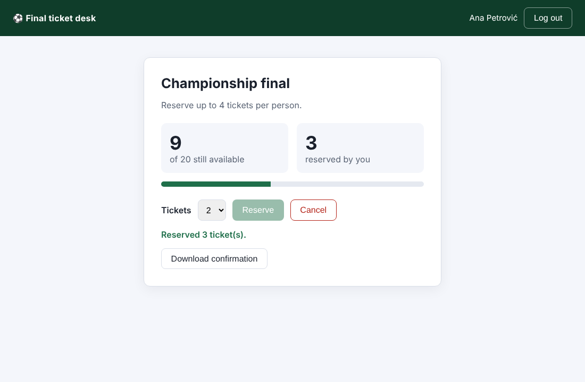
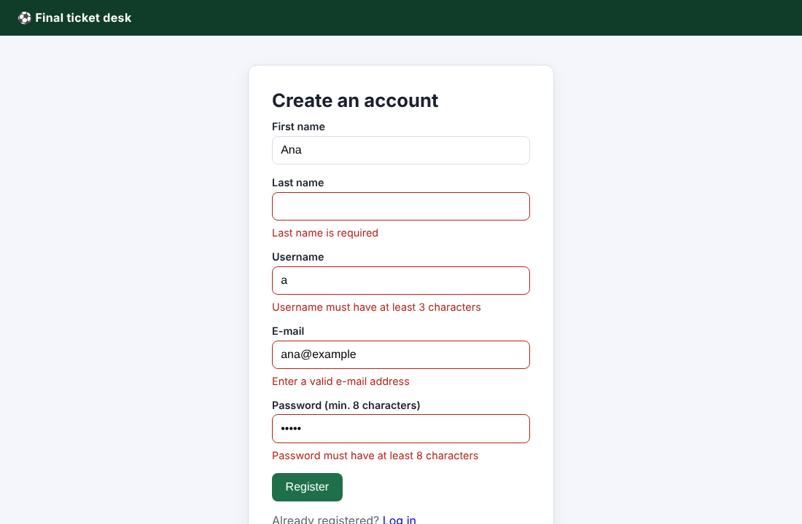
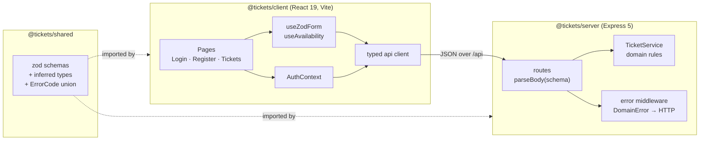

# Ticket reservation: React + TypeScript + Express

**A full-stack ticket reservation app written in strict TypeScript: a React 19 client and an Express 5 API that share one typed contract, with business rules enforced on the server and 25 automated tests running in CI.**


Users register, log in, see how many tickets are left, and reserve or cancel up to **4 tickets** out of a capacity of **20**. They can also download a confirmation.

| Reservation page | Registration with validation |
|---|---|
|  |  |

> **Background.** This is version 2 of an app first built as a university project (Create React App, Bootstrap and a JavaScript Express server). The 2026 rewrite adds strict typing end to end, validation shared by client and server, server-side business rules, safe password handling and tests. The table at the end lists what changed and why.

## Architecture



npm workspaces form a small monorepo with three packages. The **shared** package is the contract. Each request body is defined once as a [zod](https://zod.dev) schema, and its TypeScript type is derived from it with `z.infer`. So the same definition:
- validates forms in the browser,
- validates request bodies on the server,
- types both sides at compile time.

If the contract changes, the compiler points to every place that has to follow.

## TypeScript and React techniques used

| Technique | Where | Why |
|---|---|---|
| **Schema-first types** (`z.infer`) | `shared/src/index.ts` | One source of truth for validation and types |
| **Strictest compiler settings**: `strict`, `noUncheckedIndexedAccess`, `exactOptionalPropertyTypes`, `verbatimModuleSyntax` | `tsconfig.base.json` | Catches `undefined` access and optional-property mistakes at compile time |
| **String-literal union for errors** (`ErrorCode`) and `Record<ErrorCode, number>` | `shared`, `server/src/app.ts` | Adding an error code without an HTTP status is a compile error |
| **Discriminated union for async state** (`loading \| error \| ready`) | `client/src/hooks/useAvailability.ts` | The component cannot read `data` before it exists |
| **Generic hook** `useZodForm<S extends ZodObject>` | `client/src/hooks/useZodForm.ts` | Typed `values` and `errors` for any schema, reused by both forms |
| **Type guards on untrusted input** (`isApiErrorBody`, `readSession`) | `client/src/api`, `client/src/auth` | `fetch` responses and `sessionStorage` are `unknown` until checked |
| **Generic typed request helper** `request<T>()` with a custom `ApiError` class | `client/src/api/client.ts` | Every endpoint returns a concrete type, and every failure has a known `code` |
| **Context + custom hook** (`AuthProvider` / `useAuth`) | `client/src/auth/AuthContext.tsx` | Session state in one place; the hook throws when it is used outside the provider |
| **Protected routes** with redirect-back | `client/src/components/ProtectedRoute.tsx` | Anonymous users are sent to login and returned to the page they wanted |
| **Accessible forms**: `label`, `aria-invalid`, `aria-describedby`, `role="alert"` | `client/src/components/Field.tsx` | Errors are announced to screen readers, and tests query the UI the way users see it |

## Business rules (enforced by the server)

| Rule | Implementation |
|---|---|
| At most **4 tickets per user** | `TicketService.reserve` → `LIMIT_REACHED` (409) |
| **Never sell beyond capacity** (20) | `TicketService.reserve` → `SOLD_OUT` (409) |
| You can only cancel tickets you hold | `TicketService.cancel` → `NOTHING_TO_CANCEL` (409) |
| Unique usernames, case-insensitive | `TicketService.register` → `USERNAME_TAKEN` (409) |
| Only logged-in users can reserve or cancel | Bearer token → `UNAUTHORIZED` (401) |

The UI also disables buttons that would break a rule. That is only for convenience: the server is the authority, and the tests call the API directly to prove it.

`TicketService` holds the rules and knows nothing about HTTP. The Express layer only does three things: it validates the body, calls the service, and maps `DomainError` codes to status codes in one error middleware.

## Tests (25)

```bash
npm test
```

| Package | What is tested | Tool |
|---|---|---|
| `shared` (6) | Schema rules, trimming, field-error mapping | Vitest |
| `server` (12) | Domain rules: per-user limit, capacity, cancellation, duplicate users, no plain-text passwords, identical error for unknown user and wrong password. REST API: validation errors, 401 without a session, full reserve/cancel flow, logout invalidates the token, malformed JSON. | Vitest + Supertest |
| `client` (7) | Redirect to login, server error shown on wrong credentials, login stores only the token, client-side validation with no API call, taken username shown on its field, reserve updates the counters and sends the bearer token, Reserve is disabled above the limit | Vitest + Testing Library (jsdom) |

GitHub Actions runs **type check → tests → production build** on every push ([`.github/workflows/ci.yml`](.github/workflows/ci.yml)).

## Run it locally

Requires Node.js 20+.

```bash
npm install
npm run dev        # API on http://localhost:8000, app on http://localhost:5173
```

Other scripts: `npm run typecheck`, `npm test`, `npm run build`.

## What changed from version 1

| Version 1 (student project) | Version 2 | Why |
|---|---|---|
| `.tsx` files, but parameters and API data untyped | `strict` TypeScript, shared types, no `any` | Type safety is the point of TypeScript |
| Password stored and compared in plain text, kept in `localStorage` | scrypt hash with salt per user, constant-time comparison; the client stores only a session token | Basic credential hygiene |
| Registration asked for the national ID number (JMBG) | Removed | Data minimisation (GDPR): a ticket does not need it |
| Endpoint returned **all users with passwords** | Removed. The API only returns `PublicUser` (no hash). | Data leak |
| Ticket limit checked only in the browser; the counter could go negative | Limit and capacity enforced in `TicketService`, covered by tests | Never trust the client |
| Form values read through `document.forms[0]` | Controlled inputs via a typed generic hook | Idiomatic React |
| Errors as free-text strings | `ErrorCode` union + HTTP status mapping | Lets the UI react to each specific error, e.g. show a taken username on the username field |
| Create React App (deprecated), no tests | Vite, Vitest, Testing Library, CI | Current tooling |

## Limitations and next steps

- **Data lives in memory**, so a restart clears users and reservations. The service is isolated behind one class, so a PostgreSQL repository (e.g. with Prisma) could replace the maps without touching routes or UI.
- **Sessions are simple bearer tokens without expiry.** In production I would use short-lived tokens in `httpOnly` cookies, add rate limiting on login, and serve over HTTPS.
- **One event only.** Supporting several events would add an `eventId` to the reservation schema and a list page.

## Project structure

```
├── shared/src/index.ts           # zod schemas, inferred types, ErrorCode, constants
├── server/
│   ├── src/domain.ts             # TicketService + DomainError (business rules)
│   ├── src/app.ts                # Express routes, validation, error middleware
│   ├── src/index.ts              # entry point
│   └── test/                     # domain + API tests
├── client/src/
│   ├── api/client.ts             # typed fetch wrapper, ApiError
│   ├── auth/AuthContext.tsx      # session state
│   ├── hooks/                    # useZodForm (generic), useAvailability
│   ├── components/               # Field, Layout, ProtectedRoute
│   ├── pages/                    # Login, Register, Tickets
│   └── test/                     # UI tests
└── .github/workflows/ci.yml
```

---

**Author:** Ivana Ercegovac
